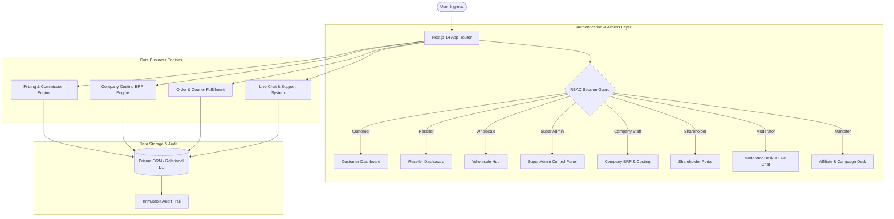

# DELIED Architecture & Technical Specification

## 1. System Overview
DELIED is an enterprise-grade multi-role fashion e-commerce and business management platform built for the Bangladesh market. It connects retail shoppers, boutique resellers, wholesale buyers, company staff, shareholders, customer support moderators, affiliate marketers, and administrators through a unified relational database and reactive App Router architecture.

---

## 2. Role-Based Access Control (RBAC) Matrix

| Module / Route | Customer | Reseller | Wholesale | Super Admin | Company Staff | Shareholder | Moderator | Marketer |
| :--- | :---: | :---: | :---: | :---: | :---: | :---: | :---: | :---: |
| **Public Storefront (`/`, `/shop`)** | ✅ | ✅ | ✅ | ✅ | ✅ | ✅ | ✅ | ✅ |
| **Retail Checkout & Cart** | ✅ | ✅ | ✅ | ✅ | ✅ | ❌ | ❌ | ❌ |
| **Customer Orders & Returns (`/dashboard/customer`)** | ✅ | ❌ | ❌ | ✅ | ❌ | ❌ | ❌ | ❌ |
| **Reseller Catalog & Wallet (`/dashboard/reseller`)** | ❌ | ✅ | ❌ | ✅ | ❌ | ❌ | ❌ | ❌ |
| **Wholesale MOQ & Bulk Hub (`/dashboard/wholesale`)** | ❌ | ❌ | ✅ | ✅ | ❌ | ❌ | ❌ | ❌ |
| **Admin Control Panel (`/dashboard/admin`)** | ❌ | ❌ | ❌ | ✅ | ❌ | ❌ | ❌ | ❌ |
| **Company Costing & ERP (`/dashboard/staff`)** | ❌ | ❌ | ❌ | ✅ | ✅ | ❌ | ❌ | ❌ |
| **Shareholder Relations (`/dashboard/shareholder`)** | ❌ | ❌ | ❌ | ✅ | ❌ | ✅ | ❌ | ❌ |
| **Moderator & Tickets (`/dashboard/moderator`)** | ❌ | ❌ | ❌ | ✅ | ❌ | ❌ | ✅ | ❌ |
| **Affiliate Campaigns (`/dashboard/marketer`)** | ❌ | ❌ | ❌ | ✅ | ❌ | ❌ | ❌ | ✅ |

---

## 3. Pricing Engine & Mathematical Formulas

### 3.1 Product Costing Equation (PRD Section 6)
$$\text{Total Production Cost} = \text{Fabric} + \text{Accessories} + \text{Printing} + \text{Labels} + \text{Packaging} + \text{Labour} + \text{Overhead} + \text{Other}$$

All production batches and inventory valuations reconcile with this base equation to ensure zero duplicate expense accounting.

### 3.2 Reseller Margin Calculation (PRD Section 5)
$$\text{Reseller Profit Per Unit} = \text{Custom Selling Price} - \text{Base Reseller Price}$$
$$\text{Reseller Margin \%} = \left(\frac{\text{Profit Per Unit}}{\text{Custom Selling Price}}\right) \times 100$$
$$\text{Company Gross Margin} = (\text{Base Reseller Price} - \text{Total Production Cost}) \times \text{Quantity}$$

*Pricing Constraint:* $\text{Base Reseller Price} \le \text{Custom Selling Price} \le 1.30 \times \text{Suggested Retail Price}$

### 3.3 Wholesale Bulk Discount Tiers
* **Tier 1:** Standard 25% wholesale discount (MOQ 20-40 pcs).
* **Tier 2:** $+3\%$ extra discount for high volume orders ($\ge 2 \times \text{MOQ}$).
* **Tier 3:** $+7\%$ extra discount for commercial lots ($\ge 5 \times \text{MOQ}$).

---

## 4. Bangladesh Logistics & Delivery Structure
* **Inside Dhaka Metro:** ৳60 delivery charge (Free over ৳2,000 threshold), 24-48 hours.
* **Outside Dhaka (All 64 Districts):** ৳120 delivery charge, 48-72 hours.
* **Integrated Courier Services:** Steadfast Courier, Pathao Parcel, RedX, Sundarban Courier.
